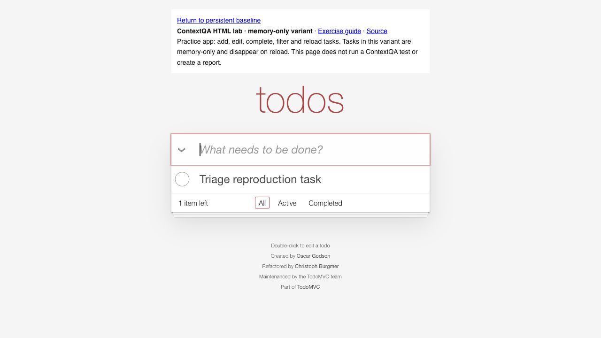
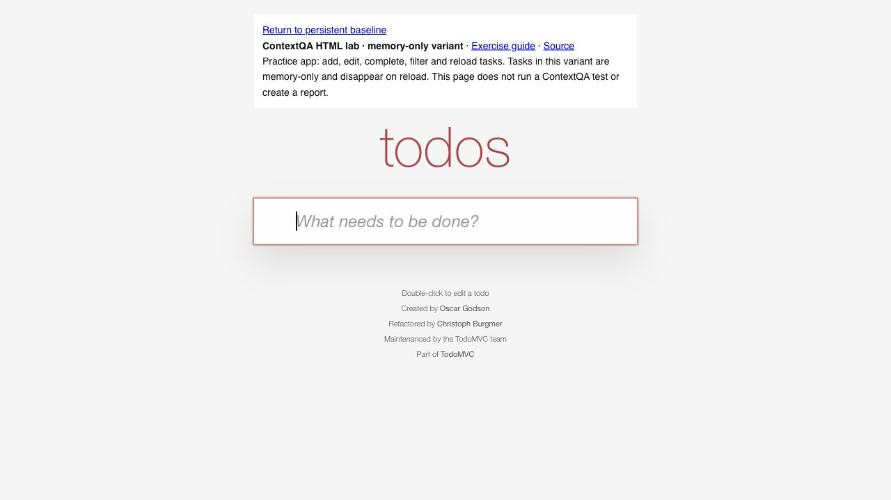
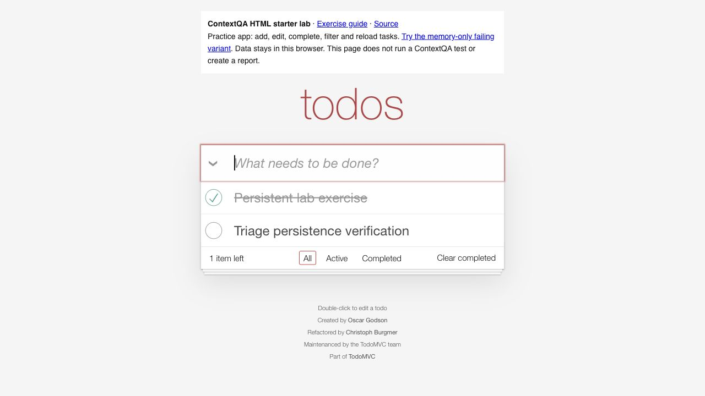

# Browser reproduction evidence — October 25, 2026

These screenshots are actual browser UI observations with synthetic task names; they are not ContextQA execution reports.

The memory-only variant shows the task before reload and its absence afterward. Repeating the same workflow on the persistent baseline shows the synthetic task after reload. This verifies the disclosed lesson and comparison, not compatibility with every browser or hosted test runner.

